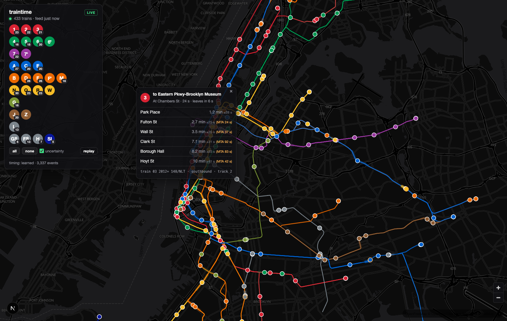

# traintime

**Every New York City subway train, moving on a map of the city — simulated from the MTA's realtime feeds, and measured against what the trains actually did.**

Live at **https://oddurs.github.io/traintime/** (runs entirely in your browser).



The MTA publishes no train positions. It publishes predicted arrival times and a coarse vehicle
status, with undocumented quirks that differ by division. traintime turns that into continuous
motion: a physical model of each train paced to a *corrected* arrival time, learned from a
recording of the feeds and scored by replay against observed station events.

## Run it

```
npm install
npm run build:network   # once: MTA static GTFS → track geometry + schedule priors
npm run dev             # web http://localhost:7117  ·  poller http://localhost:7118
```

`npm run dev` starts both the Next.js app and the **poller**, a small Node service that fetches
every feed at its own cadence, keeps every train's history, records everything to Parquet, and
streams train states to the browser over SSE. Without a poller (as on GitHub Pages) the app does
the same tracking in the browser, minus recording and replay.

Learning from your own recordings:

```
npm run learn           # station events → data/timing.json (hot-reloaded by the poller)
npm run train-model     # residual model → data/eta-model.json (only if it beats the tables)
npm run evaluate        # replay a recorded window and score it
npm run snapshot        # copy learned files into public/data for the static site
```

`train-model` needs Python: `uv venv .venv && uv pip install --python .venv/bin/python scikit-learn duckdb pandas pyarrow`.

## How a position is made

1. **Geometry.** `scripts/build-network.ts` projects every station onto the GTFS track shapes and
   slices out the track between each consecutively served pair, so a train between 59 St and
   42 St follows the real curve of the 8th Avenue line. It also records which stops precede which,
   per route, and the scheduled run time per segment.
2. **Tracking.** `src/lib/tracker.ts` diffs feed ticks into station events (arrive, depart,
   incoming, pass) using the vehicle record as the authority on *where*, and the trip update as the
   authority on *when*. It knows which feeds report departures and which don't
   (see [docs/FEED-SEMANTICS.md](docs/FEED-SEMANTICS.md)), and models what it cannot observe.
3. **Timing.** `src/lib/timing.ts` corrects the MTA's arrival prediction with learned residuals
   (per segment → route → global, by horizon) and gives each prediction a calibrated 1σ; a
   gradient-boosted model can sit on top. Run times, dwell and approach times come from the same
   recordings, with schedule and geometry as fallbacks.
4. **Motion.** `src/lib/kinematics.ts` integrates position and velocity for every train: a
   controller picks the cruise speed that meets the corrected ETA, a braking curve brings it into
   the platform, it holds when the ETA slips or the train ahead is in the way, and it never moves
   backwards. Corrections from new data change the target, not the position.
5. **Rendering.** MapLibre GL, updated every frame. The translucent ribbon under a moving train is
   ±1σ of its arrival time, drawn along the track.

## How good is it

Scored by replaying recorded ticks and comparing against the feed's own arrival timestamps
(`npm run evaluate`). First 40 minutes of recording:

| next-stop ETA, by horizon | MTA MAE | ours MAE | 1σ coverage |
|---|---|---|---|
| under 45 s | 30.0 s | 6.5 s | 86 % |
| 45 s – 2 min | 32.7 s | 25.5 s | 73 % |
| 2 – 5 min | 41.7 s | 29.6 s | 71 % |
| 5 – 15 min | 84.2 s | 46.0 s | 74 % |

Motion: 0 reversals and 0 jumps in 460 000 replayed train-seconds. Marker position at the moment a
train really arrived: median 225 m short of the platform, which is what a ~25 s ETA error at
subway speeds looks like. The learned tables are scored in-sample here; the boosted model's
time-based holdout is 34.5 s vs the MTA's 37.2 s. Everything improves with more recording —
see [docs/ROADMAP.md](docs/ROADMAP.md) for what's open.

## Poller API

| endpoint | |
|---|---|
| `GET /state` | every tracked train's state, JSON |
| `GET /stream` | SSE: `snapshot` every 60 s, `delta` on every fresh feed tick |
| `GET /replay?from=&to=&speed=` | SSE replay of a recorded window through the same tracker |
| `GET /timing`, `/recordings`, `/metrics`, `/health`, `/flush` | status |

The Next.js app proxies these at `/api/poller/*`.

## Layout

```
scripts/           build-network, learn-timing, evaluate, rebuild-events, train_eta_model.py, build-pages
services/poller/   feeds, recorder (DuckDB → Parquet), server (HTTP/SSE/replay), index
src/lib/           types, network, geo, feed, tracker, timing, gbm, kinematics, browserSource, useTrainStream
src/components/    TrainMap, Panel
public/data/       network.json + committed snapshots of timing.json and eta-model.json
docs/              FEED-SEMANTICS.md (what the feeds actually mean), ROADMAP.md (plan + results)
```

## Data and credits

- Realtime feeds: [MTA GTFS-realtime](https://api.mta.info/) (no key required).
- Static schedule: MTA `gtfs_subway.zip`, rebuilt with `npm run build:network` when it changes.
- Basemap: [OpenFreeMap](https://openfreemap.org). Map rendering: [MapLibre GL](https://maplibre.org).

MIT licensed. Contributions welcome — read [CONTRIBUTING.md](CONTRIBUTING.md) first; the evaluator
is the arbiter of what counts as better.
